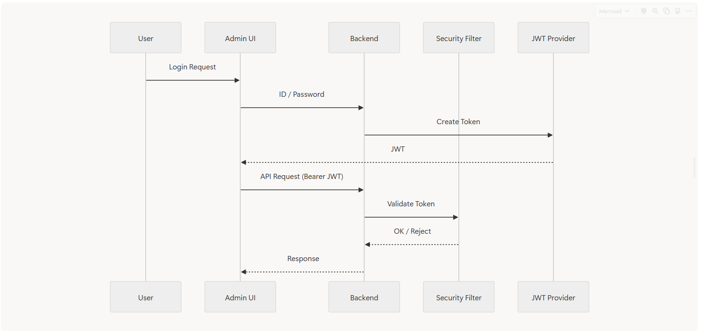
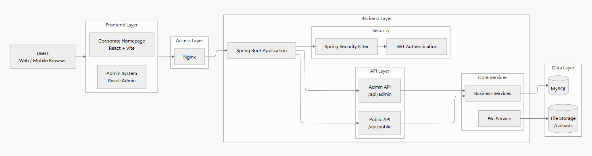
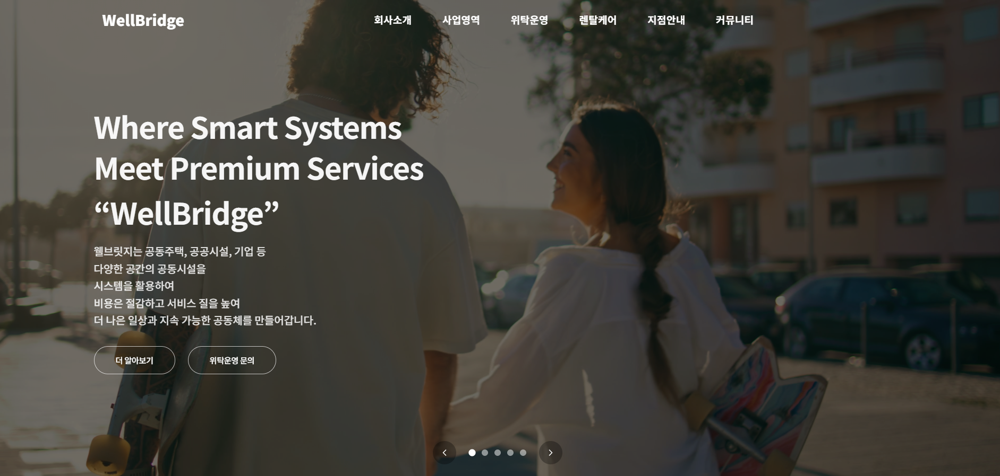
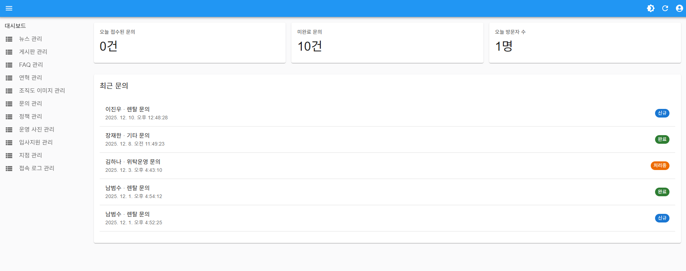
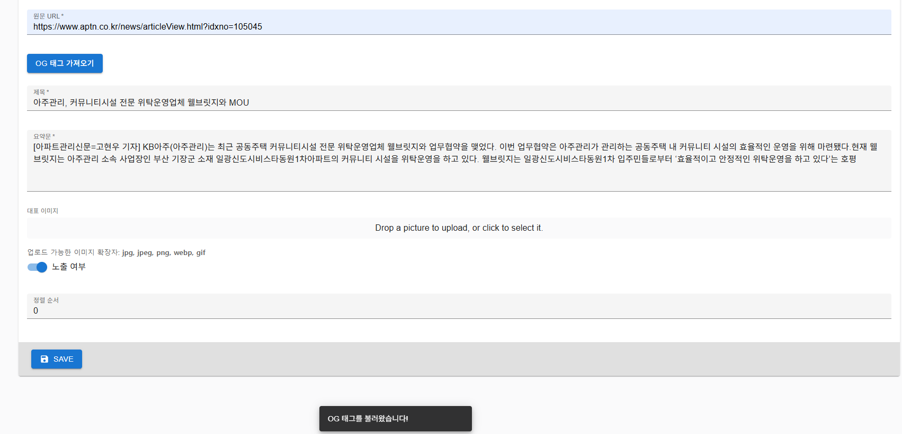

# 🏢 WellBridge 기업 홈페이지 & 관리자 시스템 (CMS)

**React (Vite) · Spring Boot · React-Admin · JWT · MySQL · PM2**

실무 환경에서 **기업 홈페이지 + 관리자(CMS)** 를 단독으로 설계·구현하고
내부 운영 환경에 배포까지 수행한 프로젝트입니다.

회사 정책상 소스코드는 비공개이며, 본 문서는 **구조·기능·기술적 의사결정 중심의 케이스 스터디**입니다.

---

## 1. 프로젝트 개요

* **프로젝트명**: WellBridge 기업 홈페이지 및 관리자 시스템
* **개발 기간**: 2024.09 ~ 2024.12
* **수행 방식**: 단독 개발 (기여도 100%)
* **배포 현황**: 내부 운영 환경 배포 및 실사용
* **코드 공개 여부**: 비공개 (사내 자산)
* **핵심 키워드**

  * CMS 구축
  * REST API 설계
  * JWT 인증/인가
  * 파일 업로드 및 이미지 관리
  * PM2 기반 운영 모니터링
  * 운영 중심 설계

---

## 2. 담당 역할 (기여도 100%)

### 👨‍💻 담당 범위

* React + Vite 기반 기업 홈페이지 프론트엔드 전체 구현
* Tailwind CSS 기반 반응형 UI 설계
* React-Admin 기반 관리자 시스템(CMS) 구축
* Spring Boot 기반 REST API 설계 및 연동
* JWT 기반 관리자 로그인 및 인증/인가 처리
* 이미지 업로드 및 파일 서빙 구조 설계
* Nginx 기반 프론트·백엔드 연동 및 운영 환경 구성
* PM2 기반 서버 모니터링 및 로그 관리 기능 구현

---

## 3. 기술 스택

| 구분             | 사용 기술                              |
| -------------- | ---------------------------------- |
| Frontend       | React (Vite), Tailwind CSS         |
| Admin UI       | React-Admin                        |
| Backend        | Spring Boot, Spring Data JPA       |
| Database       | MySQL                              |
| Authentication | JWT                                |
| File           | Multipart Upload, 서버 파일 저장         |
| Infra          | Nginx, PM2                         |
| Monitoring     | PM2 Process Monitoring, Log Viewer |

---

## 4. 시스템 아키텍처 및 설계 개요

### 📌 System Overview

* 사용자용 기업 홈페이지와 관리자 시스템 분리
* REST API 기반 데이터 통신
* 운영 환경을 고려한 계층형 구조 설계
* 관리자 시스템을 통한 콘텐츠 및 운영 관리 지원

---

### 📐 Detailed Architecture

#### Frontend

* Corporate Homepage (React + Vite)
* Admin System (React-Admin)

#### Access Layer

* Nginx
* 정적 파일 서빙
* API Reverse Proxy

#### Backend

* Spring Boot Application
* JWT Security Filter
* Admin API (`/api/admin`)
* Public API (`/api/public`)

#### Data Layer

* MySQL
* File Storage (`/uploads`)

#### Monitoring

* PM2 Process Manager
* Process Monitoring
* Server Log Viewer

---

## 5. 주요 기능

| 기능         | 설명                        |
| ---------- | ------------------------- |
| 🏠 기업 홈페이지 | 메인, 회사소개, 사업영역, 조직도, 지점안내 |
| 📰 뉴스/게시판  | 공지 및 뉴스 등록·조회             |
| 🖼 이미지 관리  | 뉴스·게시글 이미지 업로드 및 조회       |
| 📩 문의 관리   | 사용자 문의 등록 및 관리자 조회        |
| 🔐 관리자 로그인 | JWT 기반 인증 및 접근 제어         |
| 🧩 CMS     | React-Admin 기반 CRUD       |
| 📱 반응형 UI  | PC / Tablet / Mobile 대응   |
| 📈 서버 모니터링 | PM2 기반 서버 상태 확인           |
| 📜 로그 조회   | 관리자 페이지 내 실시간 로그 확인       |

---

## 6. 기술적 문제 해결 사례

### ① 이미지 업로드 구조 복잡화 문제

#### 문제

리소스별로 이미지 처리 방식이 달라 유지보수가 어렵고, 프론트엔드와 관리자 페이지에서 각각 다른 방식으로 처리되고 있었습니다.

#### 해결

* 업로드 및 파일 서빙 로직 공통화
* 이미지 URL 규칙 통일
* React-Admin DataProvider에서 이미지 처리 로직 분리

#### 결과

이미지 관련 코드 중복을 줄이고 유지보수성을 향상시켰습니다.

---

### ② 관리자 인증 및 접근 제어

#### 문제

관리자 전용 기능에 대한 보안 요구사항이 존재하였으며, 비인가 사용자의 접근을 차단할 필요가 있었습니다.

#### 해결

* JWT 기반 로그인 구현
* `/api/admin` 경로 인증 필수화
* 인증 필터를 통한 비인가 접근 차단

#### 결과

관리자 기능에 대한 접근 제어 체계를 구축하여 보안성을 강화하였습니다.

---

### ③ 뉴스 등록 시 저작권 및 입력 번거로움

#### 문제

외부 기사 내용을 관리자가 수동으로 입력해야 했으며, 출처 누락이나 저작권 문제 발생 가능성이 있었습니다.

#### 해결

외부 URL 입력 시 OG(Open Graph) 태그를 자동 수집하도록 구현했습니다.

자동으로 다음 정보를 입력하도록 구성하였습니다.

* 제목
* 요약 내용
* 대표 이미지
* 원문 링크

#### 결과

콘텐츠 등록 시간을 단축하고 출처 관리 체계를 구축하였습니다.

---

### ④ 관리자 페이지 기반 서버 모니터링 및 로그 관리

#### 문제

초기에는 서버 상태나 오류 로그를 확인하기 위해 서버에 직접 접속하여 터미널 명령어를 사용해야 했습니다.

실제 운영 환경에서는 관리자 페이지에서 서버 상태를 확인하고 장애 원인을 빠르게 파악할 수 있는 기능이 필요하다고 판단했습니다.

#### 해결

PM2를 활용하여 서버 프로세스를 관리하고, 관리자 페이지 내 서버 모니터링 기능을 직접 구현하였습니다.

다음 정보를 실시간으로 조회할 수 있도록 구성했습니다.

* 프로세스 실행 상태 (Online / Offline)
* CPU 사용량
* 메모리 사용량
* Uptime
* 재시작 횟수

또한 PM2 로그를 관리자 페이지에서 조회할 수 있도록 구현하여, 서버에 직접 접속하지 않고도 최근 오류 로그와 요청 처리 내역을 확인할 수 있도록 개선했습니다.

#### 결과

* 서버 상태를 관리자 페이지에서 실시간 확인 가능
* 장애 발생 시 원인 파악 시간 단축
* 서버 직접 접속 의존도 감소
* 운영 및 유지보수 효율 향상

---

## 7. 구현 화면

### 🏠 기업 홈페이지 메인

---

### 🔐 관리자 대시보드

---

### 📰 뉴스 등록 (OG 태그 자동 수집)

---

### 📈 서버 모니터링 및 로그 관리

* PM2 프로세스 상태 조회
* CPU / Memory 사용량 확인
* Uptime 및 Restart Count 조회
* 관리자 페이지 내 로그 조회 기능 제공

---

## 8. 결과 및 회고

### 📈 결과

* 기업 홈페이지 + 관리자 시스템 실운영 환경 구축
* 콘텐츠 관리 효율 향상
* 운영 편의성을 위한 서버 모니터링 기능 구현
* 프론트엔드–백엔드–관리자 시스템 전반을 단독 개발

### 🤔 회고

이번 프로젝트를 통해 단순히 화면과 기능을 구현하는 것을 넘어, 서비스의 구조와 운영 환경까지 고려하는 개발의 중요성을 체감하였습니다.

특히 관리자 페이지 내 서버 모니터링 및 로그 관리 기능을 직접 구현하면서 운영 중 발생하는 문제를 빠르게 파악하고 대응할 수 있는 환경을 구축할 수 있었습니다.

향후에는 API 문서화, 관리자 권한 세분화, 로그 분석 및 알림 시스템을 추가하여 운영 플랫폼을 더욱 고도화하고 싶습니다.
